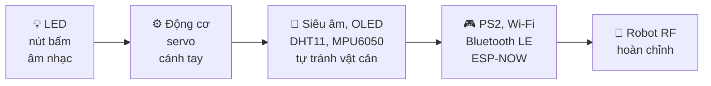

# Học Arduino cùng ThingBot

**Ebook mã nguồn mở dạy lập trình Arduino trên mạch ThingBot (ESP32-C3), từ nháy LED đến robot điều khiển RF.**




---

## Mục lục

### Mở đầu
- [Lời mở đầu](ebook/00-loi-mo-dau.md)
- [Giới thiệu mạch ThingBot](ebook/01-gioi-thieu-thingbot.md): kiến trúc, sơ đồ chân
- [Cài đặt môi trường](ebook/02-cai-dat-moi-truong.md): Arduino IDE, ESP32, thư viện

### Phần 1 – Làm quen với Arduino
| Bài | Nội dung | Kiến thức | Code |
|---|---|---|---|
| 1 | [Xin chào ThingBot](ebook/bai-01-xin-chao.md) | `setup/loop`, Serial, biến | [01](code/01_XinChao) |
| 2 | [Đèn LED nhấp nháy](ebook/bai-02-nhap-nhay.md) | PCA9685, thư viện, PWM | [02](code/02_NhapNhay) |
| 3 | [Đèn sáng dần](ebook/bai-03-sang-dan.md) | `for`, hàm, `map()` | [03](code/03_SangDan) |
| 4 | [Nút bấm SW](ebook/bai-04-nut-bam.md) | `if/else`, cạnh bấm, chống dội | [04](code/04_NutBam) |
| 5 | [Còi và âm nhạc](ebook/bai-05-am-nhac.md) | Tần số, mảng | [05](code/05_AmNhac) |
| 6 | [Đa nhiệm với millis()](ebook/bai-06-da-nhiem-millis.md) | Định thời không chặn | [06](code/06_DaNhiem_Millis) |

### Phần 2 – Chuyển động
| Bài | Nội dung | Kiến thức | Code |
|---|---|---|---|
| 7 | [Thư viện ThingBot](ebook/bai-07-thu-vien-thingbot.md) | Lớp, đối tượng, `.h/.cpp` | [07](code/07_ThuVienThingBot) |
| 8 | [Động cơ DC](ebook/bai-08-dong-co.md) | Cầu H, tăng tốc mượt (ramp) | [08](code/08_DongCo) |
| 9 | [Xe hai bánh](ebook/bai-09-xe-hai-banh.md) | Xe vi sai, căn chỉnh | [09](code/09_XeHaiBanh) |
| 10 | [Servo](ebook/bai-10-servo.md) | Độ rộng xung, lệnh Serial | [10](code/10_Servo) |
| 11 | [Cánh tay robot](ebook/bai-11-canh-tay-robot.md) | Servo song song, tư thế | [11](code/11_CanhTayRobot) |

### Phần 3 – Cảm biến
| Bài | Nội dung | Kiến thức | Code |
|---|---|---|---|
| 12 | [Cảm biến siêu âm](ebook/bai-12-sieu-am.md) | `pulseIn`, lọc trung vị | [12](code/12_SieuAm) |
| 13 | [Màn hình OLED](ebook/bai-13-oled.md) | Đồ họa, bộ đệm | [13](code/13_OLED) |
| 14 | [DHT11](ebook/bai-14-dht11.md) | NaN, min/max | [14](code/14_DHT11) |
| 15 | [MPU6050](ebook/bai-15-mpu6050.md) | Góc nghiêng, va chạm | [15](code/15_MPU6050) |
| 16 | [Xe tránh vật cản](ebook/bai-16-xe-tranh-vat-can.md) | **Máy trạng thái** | [16](code/16_XeTranhVatCan) |

### Phần 4 – Điều khiển không dây
| Bài | Nội dung | Kiến thức | Code |
|---|---|---|---|
| 17 | [Tay cầm PS2](ebook/bai-17-tay-cam-ps2.md) | RF 2.4 GHz, lái arcade | [17](code/17_TayCamPS2) |
| 18 | [Wi-Fi + trình duyệt](ebook/bai-18-wifi.md) | Access Point, web server, **failsafe** | [18](code/18_WiFi_DieuKhienWeb) |
| 19 | [Bluetooth LE](ebook/bai-19-ble.md) | GATT, Nordic UART, đa tác vụ | [19](code/19_BLE_DieuKhien) |
| 20 | [Tay điều khiển ESP-NOW](ebook/bai-20-espnow.md) | Gói tin, ID, vùng găng | [20a](code/20a_ESPNOW_TayDieuKhien) · [20b](code/20b_ESPNOW_Robot) |

### Phần 5 – Dự án cuối
| Bài | Nội dung | Code |
|---|---|---|
| 21 | [Robot điều khiển RF hoàn chỉnh](ebook/bai-21-robot-hoan-chinh.md): MANUAL/AUTO, chống đâm, failsafe, OLED | [21](code/21_RobotHoanChinh) |

### Phụ lục
- [A – Tham khảo thư viện ThingBot](ebook/phu-luc-a-thu-vien-thingbot.md)
- [B – Xử lý sự cố](ebook/phu-luc-b-xu-ly-su-co.md)

---

## Bắt đầu nhanh

1. Cài **Arduino IDE 2**, thêm board **esp32 by Espressif** (3.x) và thư viện **Adafruit PWM Servo Driver Library**.
2. Chép thư mục [`libraries/ThingBot`](libraries/ThingBot) vào `Documents/Arduino/libraries/`.
3. Chọn **ESP32C3 Dev Module**, bật **USB CDC On Boot: Enabled**.
4. Mở **File → Examples → ThingBot → ThingBotTest** rồi nạp, để kiểm tra toàn bộ phần cứng.

Hướng dẫn chi tiết: [Cài đặt môi trường](ebook/02-cai-dat-moi-truong.md).

## Sơ đồ chân tóm tắt

| PCA9685 | Kênh | | ESP32-C3 | GPIO |
|---|---|---|---|---|
| M1 / M2 / M3 / M4 | 2-3 / 4-5 / 7-6 / 1-0 | | Nút SW | IO3 |
| Servo S1…S5 | 12, 11, 10, 9, 8 | | I2C SDA / SCL | IO8 / IO9 |
| Còi | 14 | | Siêu âm TRIG / ECHO | IO0 / IO4 |
| LED_1 / LED_2 | 15 / 13 | | PS2 DAT/CMD/SEL/CLK | IO7/2/10/6 |

## Cấu trúc kho mã

```
hoc-arduino-cung-thingbot/
├── README.md                 ← trang bìa + mục lục
├── ebook/                    ← nội dung sách (Markdown)
├── code/                     ← 22 sketch Arduino theo từng bài
├── libraries/ThingBot/       ← thư viện hỗ trợ của sách
└── tools/build_all.sh        ← biên dịch kiểm tra toàn bộ bằng arduino-cli
```

## Kiểm tra biên dịch

Mọi sketch đều được biên dịch thử với `esp32:esp32:esp32c3` (Arduino-ESP32 3.3):

```bash
./tools/build_all.sh
```

## Đóng góp

Rất hoan nghênh issue và pull request: sửa lỗi, thêm bài, thêm ảnh lắp ráp, dịch sang tiếng Anh. Khi thêm sketch mới, hãy chạy `tools/build_all.sh` trước khi gửi.

## Giấy phép

- **Mã nguồn** (`code/`, `libraries/`, `tools/`): [MIT](LICENSE)
- **Nội dung sách** (`ebook/`, `README.md`): [CC BY-SA 4.0](https://creativecommons.org/licenses/by-sa/4.0/deed.vi)

ThingBot là sản phẩm của ThingEdu. Dự án này là tài liệu học tập do cộng đồng biên soạn.
