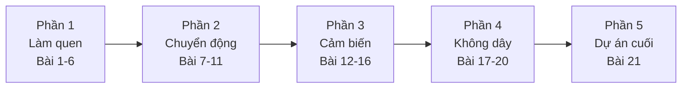

# Lời mở đầu

Chào mừng bạn đến với **Học Arduino cùng ThingBot**!

Cuốn sách này dẫn bạn đi từ lúc chưa viết dòng code nào tới lúc tự làm được một **robot điều khiển bằng sóng vô tuyến (RF)**, có chế độ tự lái, màn hình hiển thị và cơ chế an toàn khi mất sóng.

## Sách dành cho ai?

- Học sinh THCS, THPT và sinh viên mới học lập trình nhúng
- Giáo viên STEM cần giáo án Arduino có sẵn code chạy được
- Người đã quen lập trình kéo thả (ThingBlock, Scratch) và muốn chuyển sang viết code C/C++ thật

Bạn **không cần** biết lập trình trước. Mỗi khái niệm mới được giải thích ngay lúc nó xuất hiện lần đầu.

## Lộ trình

| Phần | Bạn sẽ học | Kết quả |
|---|---|---|
| 1. Làm quen | `setup/loop`, biến, `if`, `for`, hàm, mảng, `millis()` | Đèn, nút bấm, nhạc |
| 2. Chuyển động | Động cơ DC, servo, thư viện | Xe chạy hình vuông, cánh tay gắp đồ |
| 3. Cảm biến | Siêu âm, OLED, DHT11, MPU6050, máy trạng thái | Xe tự tránh vật cản |
| 4. Không dây | PS2, Wi-Fi, Bluetooth LE, ESP-NOW | Điều khiển robot từ xa bằng 4 cách |
| 5. Dự án cuối | Ghép toàn bộ kiến thức | Robot RF hoàn chỉnh |

## Cách dùng sách

1. Đọc theo thứ tự. Mỗi bài dựa trên kiến thức của bài trước.
2. **Gõ lại code** thay vì chỉ copy. Tay gõ thì não mới nhớ.
3. Làm phần **Thử thách** cuối mỗi bài. Lời giải không có sẵn, vì tự làm ra mới là học.
4. Code mẫu đầy đủ nằm trong thư mục [`code/`](../code). Code đã được biên dịch thử cho ESP32-C3.

## Quy ước trong sách

- `chữ đơn cách` là tên hàm, biến, tệp tin.
- Khối **> Lưu ý** là chỗ dễ sai, nên đọc kỹ.
- Comment trong code viết **tiếng Việt không dấu**, vì một số trình soạn thảo và màn OLED không hiển thị được dấu.

---

[Mục lục](../README.md) · Tiếp: [Giới thiệu ThingBot →](01-gioi-thieu-thingbot.md)
