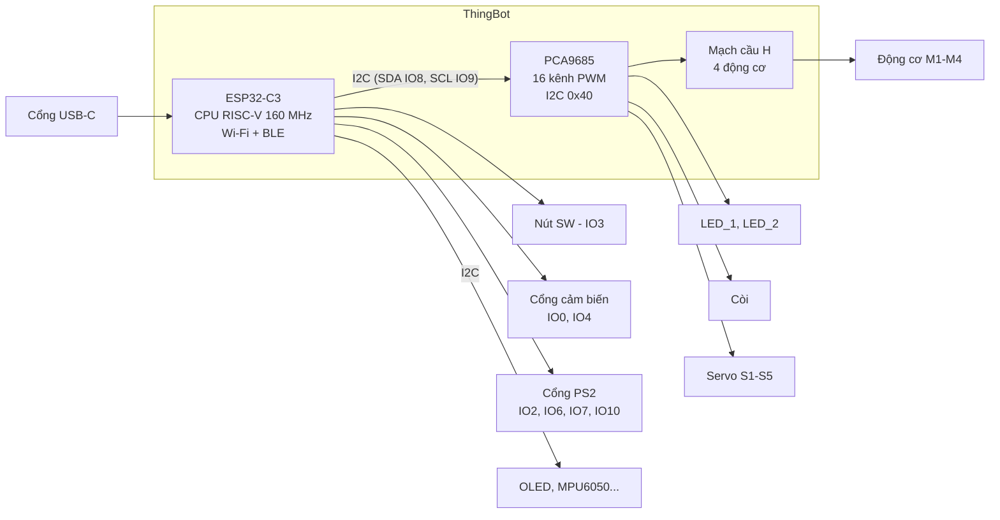

# Giới thiệu mạch ThingBot

**ThingBot** là mạch điều khiển robot giáo dục của ThingEdu. Mạch dùng chip **ESP32-C3** (có Wi-Fi và Bluetooth LE) và chip điều khiển xung **PCA9685**.

## 1. Kiến trúc mạch

ESP32-C3 có ít chân, nên ThingBot giao hết việc "xuất tín hiệu" cho chip PCA9685. ESP32 chỉ cần gửi lệnh qua 2 dây I2C, rồi PCA9685 tạo ra 16 tín hiệu PWM để điều khiển:

- **4 động cơ DC** (M1–M4), mỗi động cơ dùng 2 kênh
- **5 servo** (S1–S5)
- **2 đèn LED** và **1 còi**

> **Lưu ý quan trọng:** vì LED, còi, động cơ và servo nối vào PCA9685, bạn **không** dùng được `digitalWrite()` hay `analogWrite()` cho chúng. Phải dùng thư viện **Adafruit PWM Servo Driver**. Bài 2 sẽ hướng dẫn chi tiết.

## 2. Bảng kênh PCA9685

| Thiết bị | Kênh | Ghi chú |
|---|---|---|
| Động cơ M1 | A = 2, B = 3 | Thường là bánh trái |
| Động cơ M2 | A = 4, B = 5 | Thường là bánh phải |
| Động cơ M3 | A = 7, B = 6 | |
| Động cơ M4 | A = 1, B = 0 | |
| Servo S1 / S2 / S3 / S4 / S5 | 12 / 11 / 10 / 9 / 8 | 50 Hz |
| Còi | 14 | Còi thụ động (cần tạo sóng) |
| LED_1 | 15 | |
| LED_2 | 13 | |

## 3. Bảng chân GPIO của ESP32-C3

| Chức năng | Chân |
|---|---|
| Nút SW | IO3 (bấm = `LOW`) |
| I2C | SDA = IO8, SCL = IO9 |
| Cổng cảm biến (siêu âm) | TRIG = IO0, ECHO = IO4 |
| DHT11 | IO4 |
| Cổng tay cầm PS2 | DAT = IO7, CMD = IO2, SEL = IO10, CLK = IO6 |

Bus I2C dùng chung cho nhiều thiết bị, mỗi thiết bị có địa chỉ riêng:

| Thiết bị I2C | Địa chỉ |
|---|---|
| PCA9685 (trên mạch) | `0x40` |
| Màn OLED SSD1306 | `0x3C` |
| MPU6050 | `0x68` |

## 4. Nguồn điện

- Khi chỉ nạp code và thử LED, nút, còi, cấp nguồn qua **USB** là đủ.
- Khi chạy **động cơ hoặc servo**, phải dùng **pin** (ví dụ 2 cell Li-ion 18650) và bật công tắc nguồn. Động cơ cần dòng lớn hơn nhiều so với cổng USB cấp được.

> Mạch tự khởi động lại khi động cơ vừa quay là dấu hiệu **pin yếu**. Hãy sạc pin.

## 5. Hai cách lập trình ThingBot

| | ThingBlock (kéo thả) | Arduino C++ (sách này) |
|---|---|---|
| Phù hợp | Tiểu học, mới làm quen | THCS trở lên |
| Ưu điểm | Trực quan, có mô phỏng | Linh hoạt, làm được mọi thứ chip hỗ trợ |
| Wi-Fi, BLE, ESP-NOW | Hạn chế | Đầy đủ |

Code Arduino trong sách dùng **cùng sơ đồ chân** với ThingBlock, nên bạn có thể chuyển qua lại giữa hai cách.

---

[← Lời mở đầu](00-loi-mo-dau.md) · [Mục lục](../README.md) · Tiếp: [Cài đặt môi trường →](02-cai-dat-moi-truong.md)
