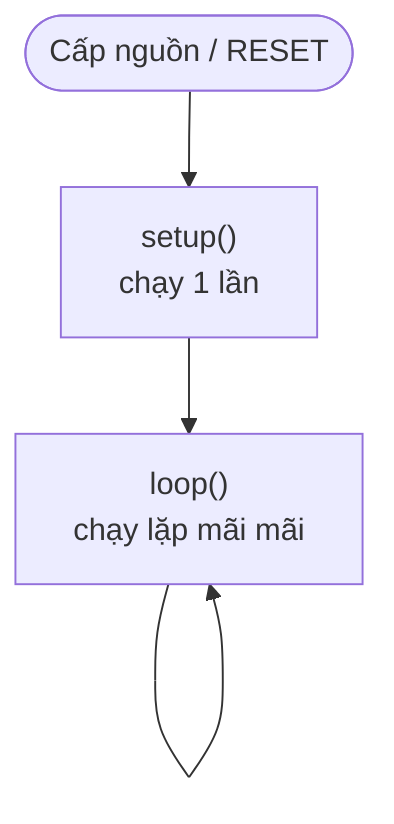

# Bài 1 – Xin chào ThingBot

> **Mục tiêu:** hiểu cấu trúc một chương trình Arduino, in chữ ra màn hình máy tính.
> **Phần cứng:** mạch ThingBot, cáp USB.
> **Code:** [`code/01_XinChao`](../code/01_XinChao/01_XinChao.ino)

## 1. Chương trình Arduino gồm những gì?

Mọi chương trình Arduino (gọi là **sketch**) đều có hai hàm bắt buộc:



| Hàm | Khi nào chạy | Thường dùng để |
|---|---|---|
| `setup()` | Một lần, ngay khi khởi động | Khởi tạo: mở Serial, cài đặt chân, khởi động thiết bị |
| `loop()` | Lặp lại liên tục sau `setup()` | Công việc chính: đọc cảm biến, điều khiển |

## 2. Code

```cpp
int counter = 0;  // bien dem

void setup() {
  Serial.begin(115200);
  delay(1500);
  Serial.println("Xin chao, minh la ThingBot!");
  Serial.print("Chip: ");
  Serial.println(ESP.getChipModel());
}

void loop() {
  counter = counter + 1;
  Serial.print("Da chay duoc ");
  Serial.print(counter);
  Serial.println(" giay");
  delay(1000);
}
```

## 3. Giải thích

- `int counter = 0;` tạo một **biến** tên `counter`, kiểu số nguyên (`int`), giá trị ban đầu là 0. Biến giống một chiếc hộp có tên để cất một con số.
- `Serial.begin(115200);` mở kênh trò chuyện giữa ThingBot và máy tính với tốc độ 115200 bit/giây.
- `Serial.print(...)` in ra nhưng **không** xuống dòng. `Serial.println(...)` in rồi **xuống dòng**.
- `delay(1000);` dừng chương trình 1000 mili giây (1 giây).
- Mỗi câu lệnh kết thúc bằng dấu **chấm phẩy `;`**.
- Chữ sau `//` là **chú thích (comment)**. Máy bỏ qua phần này, nó chỉ để người đọc hiểu code.

## 4. Kết quả

Mở **Serial Monitor** ở tốc độ 115200, bạn sẽ thấy:

```
Xin chao, minh la ThingBot!
Chip: ESP32-C3
Da chay duoc 1 giay
Da chay duoc 2 giay
...
```

> Không thấy gì? Kiểm tra lại **Tools → USB CDC On Boot → Enabled** và tốc độ baud 115200.

## 5. Thử thách

1. In thêm tên của bạn trong `setup()`.
2. Cho bộ đếm tăng mỗi **nửa giây** và đếm **ngược** từ 10 về 0.
3. Thay `counter = counter + 1;` bằng `counter++;`. Kết quả có khác không?

---

[← Cài đặt](02-cai-dat-moi-truong.md) · [Mục lục](../README.md) · Tiếp: [Bài 2 – Đèn nhấp nháy →](bai-02-nhap-nhay.md)
