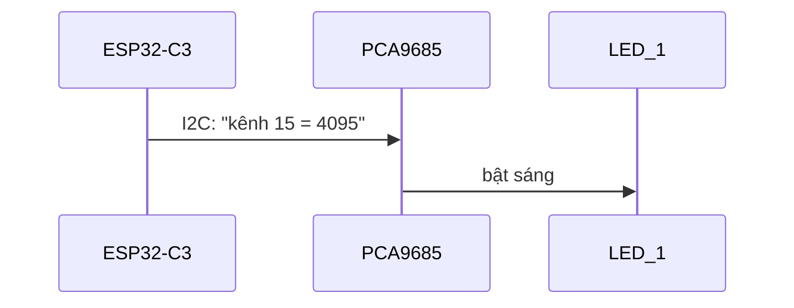

# Bài 2 – Đèn LED nhấp nháy

> **Mục tiêu:** điều khiển LED trên mạch qua chip PCA9685, dùng thư viện.
> **Phần cứng:** ThingBot (LED_1, LED_2 có sẵn trên mạch).
> **Code:** [`code/02_NhapNhay`](../code/02_NhapNhay/02_NhapNhay.ino)

## 1. Vì sao không dùng `digitalWrite()`?

Trên Arduino Uno, bạn bật LED bằng `digitalWrite(13, HIGH)`. Trên ThingBot thì LED **không nối vào ESP32** mà nối vào **kênh 15 và 13 của chip PCA9685**. Muốn bật LED, ESP32 phải "nhờ" PCA9685 qua bus I2C.



## 2. Thư viện là gì?

**Thư viện** là đoạn code người khác đã viết sẵn để bạn dùng lại. Thư viện *Adafruit PWM Servo Driver* biết cách "nói chuyện" với PCA9685, nên bạn chỉ cần gọi hàm của nó.

```cpp
#include <Wire.h>                     // thu vien I2C
#include <Adafruit_PWMServoDriver.h>  // thu vien PCA9685
```

## 3. Code

```cpp
#define LED_1 15
#define LED_2 13

Adafruit_PWMServoDriver pwm = Adafruit_PWMServoDriver();  // dia chi 0x40

void setup() {
  pwm.begin();
  pwm.setOscillatorFrequency(27000000);
  pwm.setPWMFreq(50);
}

void loop() {
  pwm.setPin(LED_1, 4095);  // bat
  pwm.setPin(LED_2, 0);     // tat
  delay(500);
  pwm.setPin(LED_1, 0);
  pwm.setPin(LED_2, 4095);
  delay(500);
}
```

## 4. Giải thích

- `#define LED_1 15` đặt **tên gọi** cho số 15. Khi biên dịch, mọi chỗ ghi `LED_1` được thay bằng 15. Code dễ đọc hơn nhiều so với ghi thẳng số.
- `Adafruit_PWMServoDriver pwm = ...;` tạo một **đối tượng** tên `pwm` đại diện cho chip PCA9685.
- Ba lệnh trong `setup()` khởi động chip. Từ đây về sau **mọi chương trình đều có đoạn này**.
- `pwm.setPin(kênh, giá_trị)`: giá trị từ `0` (tắt) đến `4095` (sáng hết mức).

> **PWM là gì?** PWM (điều chế độ rộng xung) là bật/tắt tín hiệu rất nhanh. Tỉ lệ thời gian *bật* quyết định đèn sáng mạnh hay yếu. Với PCA9685, mỗi chu kỳ chia làm 4096 phần: `setPin(k, 1024)` nghĩa là bật 1/4 thời gian, nên đèn sáng khoảng 25%.

## 5. Thử thách

1. Cho hai đèn nháy **cùng lúc** thay vì so le.
2. Làm đèn "cảnh sát": LED_1 nháy nhanh 3 lần, rồi tới LED_2 nháy nhanh 3 lần.
3. Thay `4095` bằng `300`. Đèn thay đổi thế nào?

---

[← Bài 1](bai-01-xin-chao.md) · [Mục lục](../README.md) · Tiếp: [Bài 3 – Đèn sáng dần →](bai-03-sang-dan.md)
