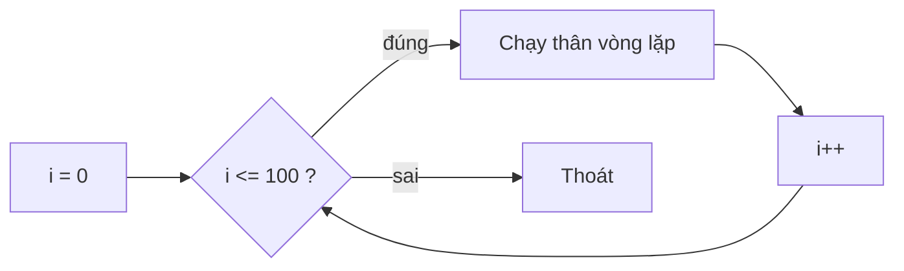

# Bài 3 – Đèn "thở": sáng dần, tắt dần

> **Mục tiêu:** dùng vòng lặp `for`, tự viết hàm, dùng `map()` và `constrain()`.
> **Code:** [`code/03_SangDan`](../code/03_SangDan/03_SangDan.ino)

## 1. Tự viết hàm

Viết `pwm.setPin(LED_1, map(...))` lặp lại nhiều lần thì vừa dài vừa dễ sai. Ta gói đoạn đó thành một **hàm** của riêng mình:

```cpp
void setLed(int led, int percent) {
  percent = constrain(percent, 0, 100);       // ep vao khoang 0..100
  int value = map(percent, 0, 100, 0, 4095);  // doi 0..100 -> 0..4095
  pwm.setPin(led, value);
}
```

- `void` nghĩa là hàm không trả về giá trị nào.
- `int led, int percent` là các **tham số**, tức dữ liệu truyền vào khi gọi hàm.
- Gọi hàm: `setLed(LED_1, 50);` cho LED_1 sáng 50%.

### `map()` và `constrain()`

| Hàm | Ví dụ | Kết quả |
|---|---|---|
| `constrain(x, a, b)` | `constrain(150, 0, 100)` | `100` (ép x vào khoảng a..b) |
| `map(x, a1, b1, a2, b2)` | `map(50, 0, 100, 0, 4095)` | `2047` (đổi tỉ lệ từ khoảng này sang khoảng kia) |

## 2. Vòng lặp `for`

```cpp
for (int i = 0; i <= 100; i++) {
  setLed(LED_1, i);
  setLed(LED_2, 100 - i);
  delay(15);
}
```



Vòng lặp chạy 101 lần, `i` đi từ 0 tới 100. LED_1 sáng dần lên trong khi LED_2 tối dần đi. Thời gian một lượt khoảng 101 × 15 ms ≈ 1,5 giây.

## 3. Thử thách

1. Làm hiệu ứng thở **chậm hơn gấp đôi**.
2. Viết hàm `blink(int led, int times)` cho đèn nháy `times` lần.
3. Mắt người cảm nhận độ sáng không tuyến tính. Thử dùng `value = percent * percent * 4095 / 10000;` và so sánh xem đèn có "mượt" hơn không.

---

[← Bài 2](bai-02-nhap-nhay.md) · [Mục lục](../README.md) · Tiếp: [Bài 4 – Nút bấm →](bai-04-nut-bam.md)
