# Bài 6 – Làm nhiều việc cùng lúc với `millis()`

> **Mục tiêu:** hiểu vì sao `delay()` làm robot "đơ", học kỹ thuật định thời không chặn.
> **Code:** [`code/06_DaNhiem_Millis`](../code/06_DaNhiem_Millis/06_DaNhiem_Millis.ino)

Đây là **bài quan trọng nhất của Phần 1**. Mọi robot ở các phần sau đều dựa trên kỹ thuật này.

## 1. Vấn đề của `delay()`

Yêu cầu: LED_1 nháy mỗi 300 ms, LED_2 nháy mỗi 1000 ms, và bấm nút thì còi kêu **ngay**.

Nếu dùng `delay(1000)`, trong 1 giây đó ESP32 **đứng im**, không đọc được nút và không đổi được LED_1. Robot dùng nhiều `delay()` giống như người nhắm mắt đi đường.

## 2. Ý tưởng: nhìn đồng hồ

`millis()` trả về số mili giây đã trôi qua kể từ khi mạch khởi động. Thay vì *ngủ* 300 ms, ta cứ liên tục **nhìn đồng hồ** và hỏi: "Đã đủ 300 ms kể từ lần trước chưa?"

```cpp
unsigned long lastLed1 = 0;

void loop() {
  unsigned long now = millis();
  if (now - lastLed1 >= 300) {   // du 300 ms chua?
    lastLed1 = now;              // ghi lai moc thoi gian
    led1 = !led1;
    pwm.setPin(LED_1, led1 ? 4095 : 0);
  }
  // ... cac viec khac chay ngay, khong phai cho
}
```



```mermaid
gantt
  dateFormat x
  axisFormat %L ms
  section LED_1 (300 ms)
  bật :0, 300
  tắt :300, 600
  bật :600, 900
  section LED_2 (1000 ms)
  bật :0, 1000
  section Nút SW
  luôn được kiểm tra :0, 1000
```

Mỗi vòng `loop()` chỉ mất vài micro giây, nên mỗi giây cả ba "việc" được kiểm tra hàng chục nghìn lần. Nhìn từ bên ngoài, robot như đang làm nhiều việc **cùng lúc**.

## 3. Còi kêu mà không dùng `delay`

```cpp
if (pressed && !lastPressed) {
  pwm.setPin(BUZZER, 2048);
  beepUntil = now + 80;          // hen gio tat sau 80 ms
}
if (beepUntil && now >= beepUntil) {
  pwm.setPin(BUZZER, 0);
  beepUntil = 0;
}
```

> **Vì sao viết `now - lastLed1 >= 300` mà không viết `now >= lastLed1 + 300`?** `millis()` dùng kiểu `unsigned long` và quay về 0 sau khoảng 49 ngày. Phép trừ vẫn cho kết quả đúng khi bộ đếm quay vòng, còn phép cộng thì không.

## 4. Thử thách

1. Thêm việc thứ 4: cứ mỗi 5 giây in `millis()` ra Serial.
2. Viết lại bài "đèn thở" (Bài 3) bằng `millis()`, sao cho trong lúc đèn đang thở, nút bấm vẫn bật/tắt được còi ngay.
3. Đo xem `loop()` chạy bao nhiêu vòng mỗi giây (đếm số vòng, mỗi giây in ra một lần rồi đặt lại về 0).

---

[← Bài 5](bai-05-am-nhac.md) · [Mục lục](../README.md) · Tiếp: [Phần 2 – Bài 7: Thư viện ThingBot →](bai-07-thu-vien-thingbot.md)
