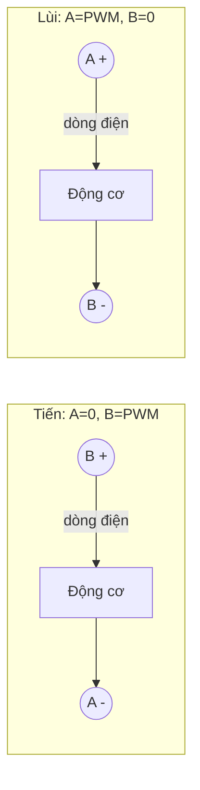

# Bài 8 – Động cơ DC

> **Mục tiêu:** điều khiển chiều quay và tốc độ động cơ, hiểu mạch cầu H.
> **Phần cứng:** động cơ DC giảm tốc (động cơ vàng TT hoặc tương tự) cắm vào cổng M1, **pin đã sạc**.
> **Code:** [`code/08_DongCo`](../code/08_DongCo/08_DongCo.ino)

## 1. Mạch cầu H

Muốn động cơ đổi chiều quay thì phải **đảo chiều dòng điện** qua nó. Mạch **cầu H** trên ThingBot làm việc này, và mỗi động cơ được điều khiển bằng 2 kênh PCA9685 (A và B):

| Kênh A | Kênh B | Động cơ |
|---|---|---|
| 0 | PWM | Quay **tiến**, tốc độ theo PWM |
| PWM | 0 | Quay **lùi** |
| 0 | 0 | **Dừng** (thả trôi) |



## 2. Bên trong hàm `ThingBot.motor()`

```cpp
void ThingBotClass::motor(uint8_t m, int speed) {   // speed: -100..100
  uint8_t a = MOTOR_A[m - 1], b = MOTOR_B[m - 1];
  int pulse = map(constrain(abs(speed), 0, 100), 0, 100, 0, 4095);
  pwm.setPWM(a, 0, speed < 0 ? pulse : 0);
  pwm.setPWM(b, 0, speed > 0 ? pulse : 0);
}
```

Một số duy nhất `speed` mang cả **chiều** (dấu +/−) lẫn **tốc độ** (độ lớn), rất tiện cho các bài sau.

## 3. Code: đổi tốc độ bằng nút

```cpp
const int speeds[] = {0, 30, 60, 100, -60};
const char *names[] = {"Dung", "Cham", "Vua", "Nhanh", "Lui"};

if (ThingBot.buttonClicked()) {
  mode = (mode + 1) % NUM_MODES;
  // tang/giam toc tu tu (ramp)
  for (int s = from; s != to; s += step) {
    ThingBot.motor(1, s);
    delay(20);
  }
}
```

**Vì sao phải tăng tốc từ từ?** Đảo chiều đột ngột từ +100 sang −60 làm động cơ hút dòng rất lớn. Pin bị sụt áp, mạch có thể tự khởi động lại, bánh răng cũng nhanh mòn hơn. Tăng hoặc giảm tốc dần (**ramp**) giúp robot chạy êm.

> **Động cơ kêu "ù ù" mà không quay** khi tốc độ thấp (dưới khoảng 25%) là chuyện bình thường. Lực từ lúc đó chưa đủ thắng ma sát. Hãy tìm tốc độ nhỏ nhất làm động cơ quay được và ghi lại.

## 4. Thử thách

1. Cho M1 và M2 quay ngược chiều nhau cùng lúc.
2. Dùng `Serial.parseInt()` để gõ tốc độ từ Serial Monitor.
3. Đo tốc độ nhỏ nhất làm bánh xe bắt đầu quay khi xe đặt trên sàn và khi xe được nhấc lên. Hai con số khác nhau vì sao?

---

[← Bài 7](bai-07-thu-vien-thingbot.md) · [Mục lục](../README.md) · Tiếp: [Bài 9 – Xe hai bánh →](bai-09-xe-hai-banh.md)
