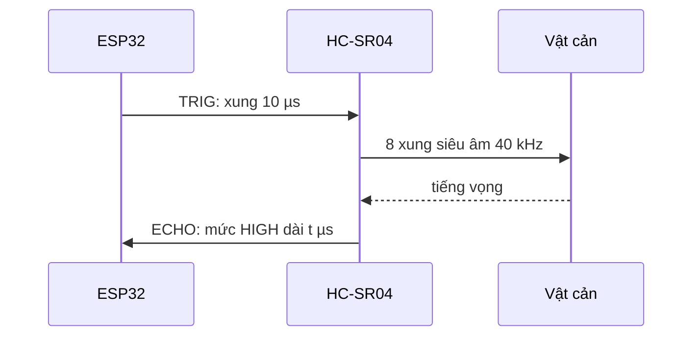

# Bài 12 – Cảm biến siêu âm HC-SR04

> **Mục tiêu:** đo khoảng cách bằng sóng siêu âm, lọc nhiễu, vẽ đồ thị bằng Serial Plotter.
> **Phần cứng:** HC-SR04 cắm cổng cảm biến: **TRIG → IO0**, **ECHO → IO4**.
> **Code:** [`code/12_SieuAm`](../code/12_SieuAm/12_SieuAm.ino)

## 1. Nguyên lý

Cảm biến phát ra một chùm sóng âm 40 kHz (tai người không nghe được), rồi đo thời gian chờ tiếng vọng quay về, giống cách con dơi định hướng.



Âm thanh đi khoảng **0,0343 cm/µs**, và quãng đường đo được gồm cả *đi* lẫn *về*:

**khoảng cách (cm) = t × 0,0343 / 2**

## 2. Bên trong `ThingBot.distanceCm()`

```cpp
digitalWrite(TRIG, HIGH);
delayMicroseconds(10);
digitalWrite(TRIG, LOW);
unsigned long t = pulseIn(ECHO, HIGH, 30000);  // cho toi da 30 ms
if (t == 0) return -1;                         // khong co tieng vong
return t * 0.0343 / 2.0;
```

`pulseIn()` đo độ dài xung HIGH trên chân ECHO. Thời gian chờ tối đa 30 ms tương ứng khoảng 5 m. Quá thời gian đó mà không có tiếng vọng thì hàm trả về `-1`.

## 3. Lọc nhiễu bằng trung vị

Thỉnh thoảng cảm biến trả về một giá trị "điên" (sóng dội lệch, vật mềm hấp thụ âm). Cách xử lý đơn giản là đo 3 lần rồi lấy **giá trị ở giữa** (trung vị):

```cpp
float readFiltered() {
  float a = ThingBot.distanceCm(), b = ..., c = ...;
  return max(min(a, b), min(max(a, b), c));   // trung vi cua 3 so
}
```

Ví dụ ba lần đo được 30, **250**, 31 thì trung vị là 31: giá trị sai đã bị loại.

## 4. Cảm biến lùi xe

Vật càng gần thì còi bíp càng dồn dập:

```cpp
if (d < 10)       { /* keu lien tuc */ }
else if (d < 60)  { ThingBot.beep(40); delay(map(d, 10, 60, 50, 600)); }
```

## 5. Serial Plotter

In theo dạng `ten:gia_tri` rồi mở **Tools → Serial Plotter**, bạn sẽ thấy đồ thị khoảng cách theo thời gian:

```cpp
Serial.printf("khoang_cach:%.1f\n", d);
```

> Tầm đo tin cậy khoảng **2–400 cm**. Vật mềm (vải, rèm) hoặc mặt nghiêng có thể không phản xạ sóng về cảm biến. Giữa hai lần đo nên nghỉ ít nhất 30 ms để tiếng vọng cũ tắt hẳn.

## 6. Thử thách

1. Làm **thước đo điện tử**: bấm SW thì in khoảng cách trung bình của 10 lần đo.
2. Làm **đàn không dây**: đổi khoảng cách 5–50 cm thành nốt Đô tới Đô cao.
3. Gắn cảm biến lên servo S1, quét 0 → 180° và in ra hướng có vật gần nhất (một "radar" mini).

---

[← Bài 11](bai-11-canh-tay-robot.md) · [Mục lục](../README.md) · Tiếp: [Bài 13 – Màn hình OLED →](bai-13-oled.md)
