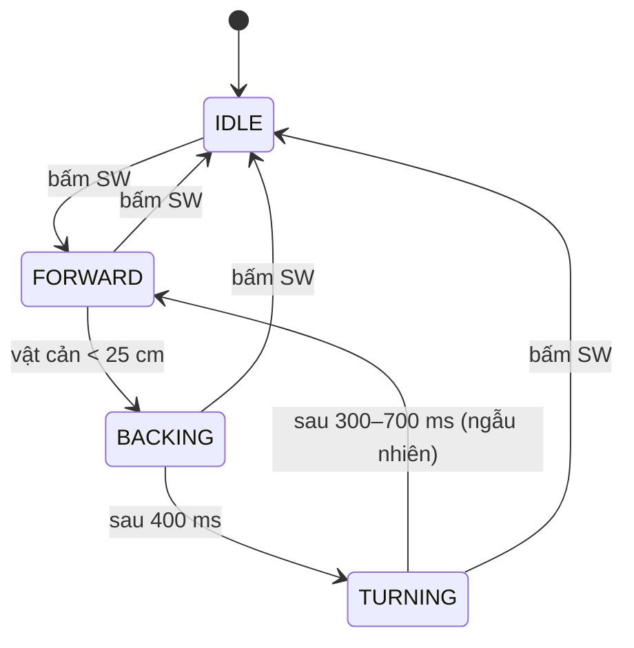

# Bài 16 – Xe tránh vật cản với máy trạng thái

> **Mục tiêu:** thiết kế hành vi robot bằng **máy trạng thái (state machine)**, không dùng `delay()`.
> **Phần cứng:** xe 2 bánh (M1 trái, M2 phải) + siêu âm (TRIG IO0, ECHO IO4) gắn đầu xe.
> **Code:** [`code/16_XeTranhVatCan`](../code/16_XeTranhVatCan/16_XeTranhVatCan.ino)

## 1. Vì sao cần máy trạng thái?

Cách viết "ngây thơ":

```cpp
if (distance < 25) {
  drive(-60, -60); delay(400);   // lui
  drive(55, -55);  delay(500);   // xoay
}
```

Trong 0,9 giây đó robot **mù và điếc**: bấm SW không dừng được, cảm biến không được đọc. Khi robot có thêm nhiều chức năng, code kiểu này nhanh chóng thành một mớ rối.

**Máy trạng thái** mô tả robot như một tập hợp các **trạng thái**. Ở mỗi thời điểm robot chỉ ở một trạng thái, và chuyển sang trạng thái khác khi có **sự kiện**:



## 2. Cài đặt trong code

**Liệt kê trạng thái** bằng `enum`:

```cpp
enum State { IDLE, FORWARD, BACKING, TURNING };
State state = IDLE;
```

**Hàm `enter()`** thực hiện các việc cần làm *một lần* khi bước vào trạng thái mới (bật động cơ, đổi LED, ghi mốc thời gian):

```cpp
void enter(State s) {
  state = s;
  stateStart = millis();
  switch (s) {
    case FORWARD: ThingBot.drive(SPEED, SPEED); break;
    case BACKING: ThingBot.drive(-SPEED, -SPEED); break;
    ...
  }
}
```

**Trong `loop()`**, mỗi trạng thái chỉ kiểm tra *điều kiện để chuyển đi*:

```cpp
switch (state) {
  case FORWARD: if (distance < OBSTACLE_CM) enter(BACKING); break;
  case BACKING: if (now - stateStart >= BACK_MS) enter(TURNING); break;
  case TURNING: if (now - stateStart >= turnMs) enter(FORWARD); break;
}
```

Nút SW và cảm biến được xử lý **bên ngoài** `switch`, nên chúng luôn phản hồi ở mọi trạng thái.

## 3. Ưu điểm

- **Dễ mở rộng:** muốn thêm trạng thái `CELEBRATE` (nhảy múa khi bấm SW 2 lần) thì chỉ cần thêm một `case`.
- **Dễ gỡ lỗi:** mỗi lần đổi trạng thái đều in tên ra Serial, nên ta biết chính xác robot đang "nghĩ" gì.
- **Không chặn:** chương trình không bao giờ phải ngồi chờ.

## 4. Thử thách

1. Thêm trạng thái `STUCK`: nếu chuyển qua lại giữa FORWARD và BACKING quá 5 lần trong 10 giây thì robot quay 180°.
2. Thêm servo S1 quay cảm biến sang trái và phải để chọn hướng **thoáng hơn** thay vì rẽ ngẫu nhiên.
3. Vẽ sơ đồ trạng thái cho một robot **đi theo vạch** (line follower).

---

[← Bài 15](bai-15-mpu6050.md) · [Mục lục](../README.md) · Tiếp: [Phần 4 – Bài 17: Tay cầm PS2 →](bai-17-tay-cam-ps2.md)
