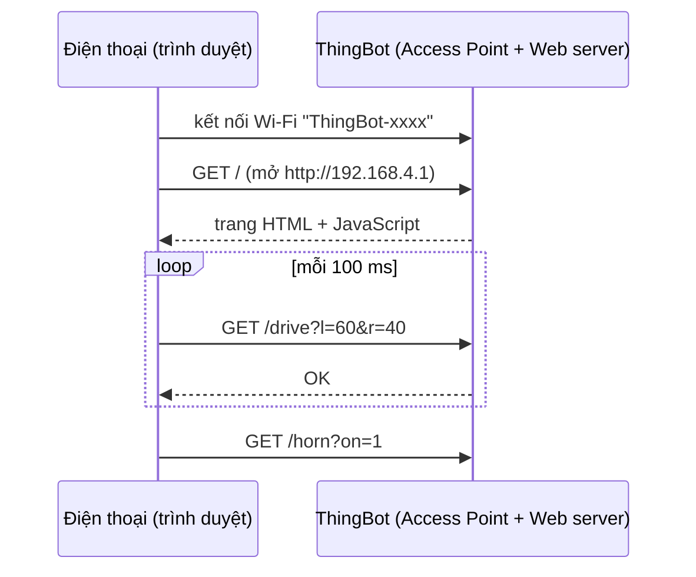

# Bài 18 – Điều khiển qua Wi-Fi bằng trình duyệt

> **Mục tiêu:** biến ThingBot thành điểm phát Wi-Fi và web server, điều khiển bằng joystick ảo trên điện thoại, có failsafe.
> **Phần cứng:** xe 2 bánh. Điện thoại hoặc máy tính bảng bất kỳ (không cần cài app).
> **Code:** [`code/18_WiFi_DieuKhienWeb`](../code/18_WiFi_DieuKhienWeb/18_WiFi_DieuKhienWeb.ino)

## 1. Mô hình hoạt động



- **Access Point (AP):** ThingBot tự phát Wi-Fi riêng, không cần router. Điện thoại kết nối trực tiếp vào robot.
- **Web server:** ThingBot trả về trang web khi được truy cập, và nhận lệnh qua các đường dẫn như `/drive?l=..&r=..`.

## 2. Phía robot (C++)

```cpp
WiFi.mode(WIFI_AP);
WiFi.softAP(ssid, "thingbot123");        // mat khau toi thieu 8 ky tu

server.on("/", handleRoot);             // tra ve trang web
server.on("/drive", handleDrive);       // nhan lenh lai
server.begin();

void handleDrive() {
  ThingBot.drive(server.arg("l").toInt(), server.arg("r").toInt());
  lastCmd = millis();
  server.send(200, "text/plain", "OK");
}

void loop() {
  server.handleClient();                       // xu ly yeu cau den
  if (millis() - lastCmd > 500) ThingBot.stop(); // FAILSAFE
}
```

Tên Wi-Fi được ghép thêm 4 ký tự cuối của địa chỉ MAC (ví dụ `ThingBot-3FA2`), nên cả lớp bật robot cùng lúc mà không bị trùng tên.

## 3. Phía điện thoại (HTML + JavaScript)

Trang web được lưu ngay trong code dưới dạng chuỗi `R"rawliteral( ... )rawliteral"`. JavaScript trong trang làm 3 việc:

1. Bắt sự kiện chạm (`pointerdown`, `pointermove`, `pointerup`) để di chuyển núm joystick.
2. Đổi vị trí núm `(x, y)` thành tốc độ hai bánh bằng công thức arcade của Bài 17.
3. Cứ mỗi 100 ms gửi `fetch('/drive?l=..&r=..')`.

## 4. Failsafe: nguyên tắc an toàn số 1

> **Robot điều khiển từ xa phải tự dừng khi mất liên lạc.**

Nếu điện thoại mất sóng, tắt màn hình hoặc người dùng chuyển app, lệnh cuối cùng (ví dụ "chạy 100%") sẽ còn hiệu lực mãi, và robot lao đi không ai điều khiển được. Giải pháp: điện thoại gửi lệnh **liên tục**, còn robot đếm thời gian từ lệnh gần nhất. Quá 500 ms không có lệnh thì dừng.

Mọi bài điều khiển không dây sau này đều áp dụng nguyên tắc này.

## 5. Thử thách

1. Thêm thanh trượt **tốc độ tối đa** trên trang web.
2. Thêm endpoint `/status` trả về khoảng cách siêu âm, rồi hiển thị nó trên trang mỗi giây.
3. Chuyển sang chế độ **Station**: robot kết nối vào Wi-Fi của nhà hoặc lớp học (`WiFi.begin(ssid, pass)`), rồi in IP ra Serial.

---

[← Bài 17](bai-17-tay-cam-ps2.md) · [Mục lục](../README.md) · Tiếp: [Bài 19 – Bluetooth LE →](bai-19-ble.md)
