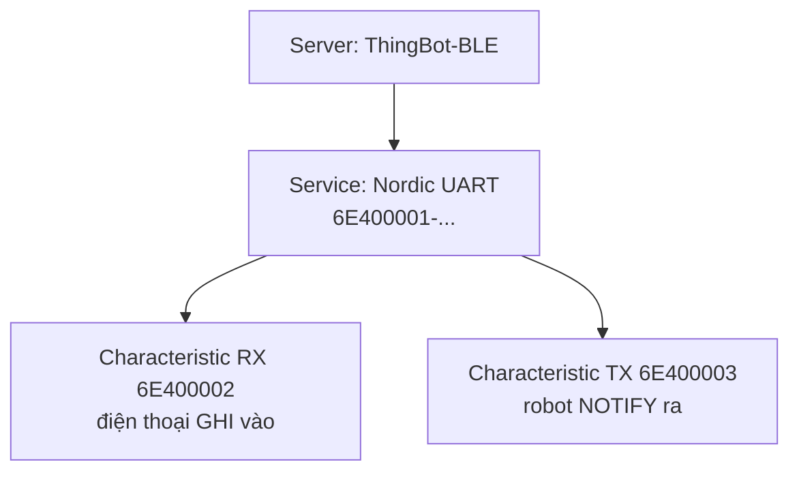

# Bài 19 – Điều khiển bằng Bluetooth Low Energy (BLE)

> **Mục tiêu:** tạo dịch vụ BLE theo chuẩn Nordic UART, điều khiển robot bằng app điện thoại, gửi dữ liệu ngược về điện thoại.
> **Phần cứng:** xe 2 bánh, servo S1 (tùy chọn).
> **App:** *Adafruit Bluefruit Connect* (Android/iOS) **hoặc** *Serial Bluetooth Terminal* (Android).
> **Code:** [`code/19_BLE_DieuKhien`](../code/19_BLE_DieuKhien/19_BLE_DieuKhien.ino)

## 1. BLE khác gì Wi-Fi?

| | Wi-Fi (Bài 18) | BLE |
|---|---|---|
| Kết nối | Điện thoại rời mạng Wi-Fi đang dùng | Điện thoại **vẫn giữ** Wi-Fi hoặc 4G |
| Tầm xa | ~30–50 m | ~10–30 m |
| Năng lượng | Cao | **Rất thấp** |
| Giao diện | Trang web tự viết | App có sẵn |

## 2. Khái niệm BLE



- **Server:** thiết bị cung cấp dữ liệu, ở đây là ThingBot.
- **Service:** một nhóm chức năng, có mã định danh UUID.
- **Characteristic:** một "ô dữ liệu" bên trong service. Điện thoại có thể đọc, ghi hoặc đăng ký nhận thông báo.
- **Nordic UART Service (NUS):** chuẩn phổ biến để truyền chuỗi ký tự qua BLE, giống một cổng Serial không dây. Nhiều app hỗ trợ sẵn chuẩn này.

## 3. Nhận lệnh

Hàm `onWrite()` được gọi mỗi khi điện thoại gửi dữ liệu tới:

```cpp
class RxCallbacks : public BLECharacteristicCallbacks {
  void onWrite(BLECharacteristic *c) override {
    String v = c->getValue();
    if (v[0] == '!' && v[1] == 'B') handleBluefruit(v);  // Control Pad
    else handleText(v);                                 // lenh chu
  }
};
```

### Cách 1: Bluefruit Connect → Controller → Control Pad

App gửi gói tin `!B` + `số nút` + `1/0` (bấm/nhả) + checksum:

| Nút | Chức năng |
|---|---|
| ↑ ↓ ← → (5, 6, 7, 8) | Di chuyển khi giữ, dừng khi nhả |
| 1 | Còi |
| 2 | Đổi tốc độ 60 → 100 → 30 |
| 3 / 4 | Servo S1 mở / đóng |

### Cách 2: gõ lệnh chữ

`F` tiến · `B` lùi · `L` trái · `R` phải · `S` dừng · `H` còi · `M 60 -60` đặt tốc độ hai bánh.

## 4. Quy tắc quan trọng: không gọi I2C trong callback

Callback BLE chạy trên **một tác vụ khác** với `loop()`. Nếu cả hai cùng gửi lệnh I2C tới PCA9685 một lúc, dữ liệu trên bus có thể bị hỏng. Vì vậy callback chỉ **ghi lệnh vào biến**, còn `loop()` mới là nơi điều khiển phần cứng:

```cpp
volatile int cmdLeft = 0, cmdRight = 0;   // callback ghi
void loop() {
  ThingBot.drive(cmdLeft, cmdRight);      // loop thuc thi
}
```

Từ khóa `volatile` báo cho trình biên dịch biết biến có thể bị thay đổi "từ bên ngoài" (bởi tác vụ khác), nên mỗi lần dùng phải đọc lại từ bộ nhớ.

**Failsafe:** khi điện thoại ngắt kết nối, `onDisconnect()` đặt tốc độ về 0 và phát quảng bá lại để chờ kết nối mới.

## 5. Gửi dữ liệu về điện thoại

```cpp
txChar->setValue("Khoang cach: 42 cm\n");
txChar->notify();
```

Mỗi giây robot gửi khoảng cách siêu âm về, và nó hiện lên trong phần UART của app.

## 6. Thử thách

1. Thêm lệnh `P` để robot phát một bài nhạc từ Bài 5.
2. Dùng chế độ **Color Picker** của Bluefruit (gói `!C` + R G B) để đặt độ sáng LED_1/LED_2 theo màu đỏ và xanh.
3. Thêm failsafe theo thời gian, giống Bài 18: đang giữ nút mà quá 1 giây không có gói tin mới thì dừng.

---

[← Bài 18](bai-18-wifi.md) · [Mục lục](../README.md) · Tiếp: [Bài 20 – ESP-NOW →](bai-20-espnow.md)
