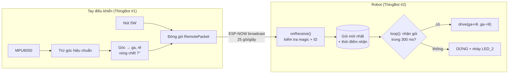

# Bài 20 – Tay điều khiển RF tự làm với ESP-NOW

> **Mục tiêu:** tự chế tay điều khiển không dây từ một ThingBot thứ hai, điều khiển bằng cách **nghiêng tay**. Thiết kế gói tin, lọc theo ID và failsafe.
> **Phần cứng:**
> - **Tay điều khiển:** ThingBot #1 + MPU6050 (cổng I2C) + pin
> - **Robot:** ThingBot #2 + xe 2 bánh (M1 trái, M2 phải)
>
> **Code:** [`code/20a_ESPNOW_TayDieuKhien`](../code/20a_ESPNOW_TayDieuKhien/20a_ESPNOW_TayDieuKhien.ino) (nạp vào tay điều khiển) · [`code/20b_ESPNOW_Robot`](../code/20b_ESPNOW_Robot/20b_ESPNOW_Robot.ino) (nạp vào robot)

## 1. ESP-NOW là gì?

**ESP-NOW** là giao thức vô tuyến 2.4 GHz do Espressif phát triển. Các chip ESP32 dùng nó để nhắn tin **trực tiếp** cho nhau:

| | ESP-NOW | Wi-Fi web | BLE |
|---|---|---|---|
| Cần router hay app | **Không** | Không router, cần trình duyệt | Cần app |
| Độ trễ | **~1–5 ms** | 20–100 ms | 10–50 ms |
| Tầm xa (ngoài trời) | **~100 m+** | ~50 m | ~30 m |
| Kết nối | Không cần bắt tay, bật lên là gửi được | Phải kết nối Wi-Fi | Phải ghép nối |

Đây là lựa chọn lý tưởng cho **tay điều khiển RF**: nhanh, xa và đáng tin cậy.

## 2. Kiến trúc



## 3. Thiết kế gói tin

```cpp
struct __attribute__((packed)) RemotePacket {
  uint16_t magic;       // 0x7B07: nhan dien goi tin cua sach nay
  uint8_t robotId;      // robot nao duoc phep nhan
  int8_t throttle;      // -100..100
  int8_t turn;          // -100..100
  uint8_t buttons;      // bit0 = dang giu SW
  uint8_t clickCount;   // tang moi lan bam SW
};
```

- `struct` gom nhiều trường thành một khối dữ liệu 8 byte, gửi đi trong một lần.
- `__attribute__((packed))` bảo trình biên dịch không chèn byte đệm, để hai bên chắc chắn hiểu gói tin giống nhau.
- **`magic`** giúp robot bỏ qua gói tin "lạ" từ các thiết bị ESP-NOW khác.
- **`robotId`**: gói được gửi **broadcast** (tới mọi thiết bị), nên trong lớp học có 10 nhóm thì mỗi nhóm đặt `ROBOT_ID` khác nhau. Robot chỉ nghe tay điều khiển cùng ID với mình.
- **`clickCount`** là bộ đếm chứ không phải cờ "vừa bấm". Nếu dùng cờ, gói tin mang cờ có thể bị mất trên đường truyền. Còn với bộ đếm, robot chỉ cần so số mới với số cũ là biết đã có lần bấm, kể cả khi lỡ mất vài gói. Bài 21 dùng trường này để đổi chế độ.

> **Quy tắc:** struct gói tin phải **giống hệt nhau** ở cả hai chương trình. Sửa một bên mà quên bên kia thì robot sẽ bỏ qua mọi gói tin, vì kiểm tra `len != sizeof(...)` thất bại.

## 4. Gửi (tay điều khiển)

```cpp
WiFi.mode(WIFI_STA);
esp_wifi_set_channel(RF_CHANNEL, WIFI_SECOND_CHAN_NONE);
esp_now_init();
// them dia chi broadcast FF:FF:FF:FF:FF:FF lam "peer"
esp_now_send(BROADCAST, (uint8_t *)&pkt, sizeof(pkt));   // 25 lan/giay
```

**Hiệu chuẩn:** lúc khởi động (LED_2 sáng khoảng 1 giây), hãy giữ tay điều khiển **nằm ngang**. Chương trình lấy trung bình 20 lần đo làm "góc 0", nên bạn không cần gắn MPU6050 thật phẳng.

**Ánh xạ góc thành tốc độ:** nghiêng dưới 7° thì coi là 0 (vùng chết), nghiêng 35° là 100%. Nếu xe chạy ngược chiều mong muốn, đặt `INVERT_THROTTLE` hoặc `INVERT_TURN` thành `true`.

## 5. Nhận (robot)

```cpp
void onReceive(const esp_now_recv_info_t *info, const uint8_t *data, int len) {
  if (len != sizeof(RemotePacket)) return;
  ...
  if (p.magic != 0x7B07 || p.robotId != ROBOT_ID) return;
  portENTER_CRITICAL(&rxMux);
  lastPkt = p;
  lastRxMs = millis();
  portEXIT_CRITICAL(&rxMux);
}
```

- Giống như ở Bài 19, callback chạy trên **tác vụ Wi-Fi**, nên nó chỉ cất gói tin vào bộ nhớ đệm. Mọi lệnh điều khiển động cơ nằm trong `loop()`.
- `portENTER_CRITICAL` / `portEXIT_CRITICAL` tạo **vùng găng**: trong lúc chép struct, tác vụ kia không được chen vào. Nhờ vậy `loop()` không bao giờ đọc phải một gói tin "nửa cũ nửa mới".

**Failsafe:** quá 300 ms (khoảng 7 gói liên tiếp) không nhận được gì thì robot dừng và LED_2 nháy. Bạn có thể thử bằng cách rút pin tay điều khiển trong lúc xe đang chạy.

## 6. Kiểm tra chất lượng sóng

Serial Monitor của robot in ra mỗi giây:

```
Song: OK | 25 goi/giay | ga 64 re -12
```

Nếu số gói/giây giảm mạnh thì robot đang ở xa hoặc vùng đó nhiễu nhiều. Khi đó, hãy thử đổi `RF_CHANNEL` (1, 6, 11 là ba kênh không chồng lấn) ở **cả hai** chương trình.

## 7. Thử thách

1. Gửi ngược dữ liệu: robot gửi khoảng cách siêu âm về tay điều khiển, và tay điều khiển rung còi khi robot sắp đâm vào vật.
2. Thay MPU6050 bằng **module joystick analog**. Lưu ý: ADC của ESP32-C3 chỉ chịu tối đa 3,3 V, nên phải cấp 3,3 V cho joystick.
3. Ghép đôi bằng địa chỉ MAC thay vì broadcast: in `WiFi.macAddress()` của robot, rồi gửi thẳng tới địa chỉ đó.

---

[← Bài 19](bai-19-ble.md) · [Mục lục](../README.md) · Tiếp: [Bài 21 – Robot hoàn chỉnh →](bai-21-robot-hoan-chinh.md)
