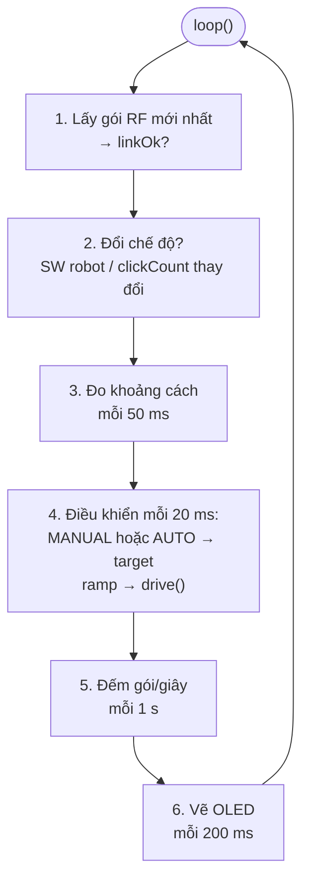
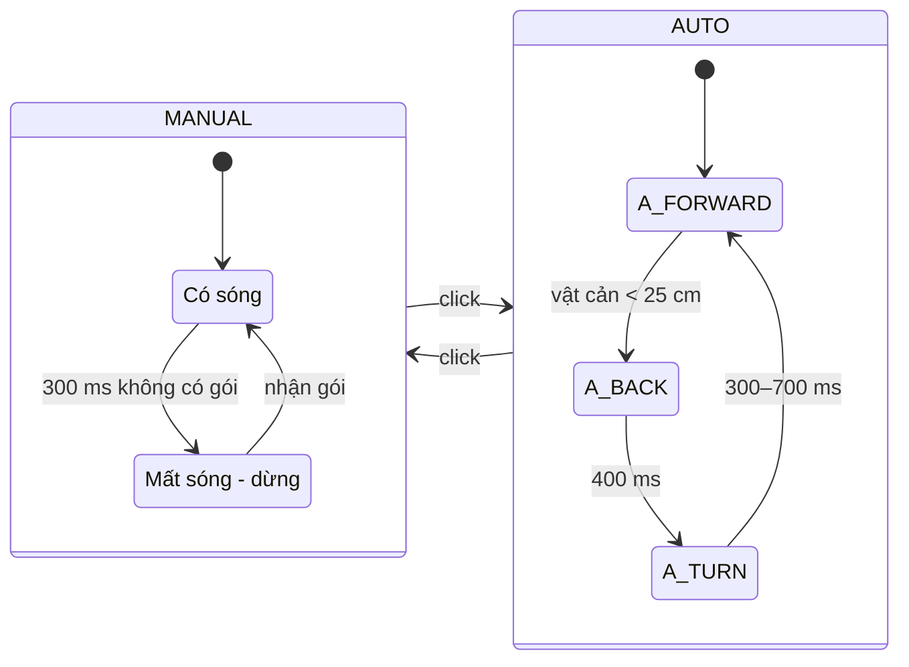

# Bài 21 – Dự án cuối: Robot điều khiển RF hoàn chỉnh

> **Mục tiêu:** ghép toàn bộ kiến thức của sách thành một robot "thật" có hai chế độ lái tay và tự hành, chống đâm, failsafe, tăng tốc mượt và màn hình trạng thái.
> **Phần cứng robot:** xe 2 bánh (M1 trái, M2 phải), siêu âm (TRIG IO0, ECHO IO4), OLED SSD1306 (tùy chọn).
> **Tay điều khiển:** dùng nguyên tay điều khiển của [Bài 20](bai-20-espnow.md) (`20a`), không cần sửa gì.
> **Code:** [`code/21_RobotHoanChinh`](../code/21_RobotHoanChinh/21_RobotHoanChinh.ino)

## 1. Tính năng

| Tính năng | Kiến thức từ bài |
|---|---|
| Lái bằng tay điều khiển nghiêng (ESP-NOW) | 15, 20 |
| Chế độ **AUTO** tự tránh vật cản | 12, 16 |
| Đổi chế độ bằng SW trên tay điều khiển **hoặc** trên robot | 4, 20 |
| **Chống đâm:** ở chế độ MANUAL, vật cản gần hơn 15 cm thì không cho tiến thêm | 12 |
| **Failsafe:** mất sóng 300 ms thì dừng | 18, 20 |
| **Ramp:** tăng/giảm tốc mượt | 8 |
| Màn hình: chế độ, sóng RF, khoảng cách, tốc độ 2 bánh | 13 |
| Âm thanh khởi động và âm báo đổi chế độ | 5 |
| Mọi thứ chạy song song, không dùng `delay()` | 6, 16 |

## 2. Kiến trúc chương trình

`loop()` được chia thành các **nhiệm vụ**, mỗi nhiệm vụ có nhịp chạy riêng (kỹ thuật `millis()` của Bài 6):





## 3. Các kỹ thuật chính

### 3.1. Tách "mong muốn" và "thực tế"

```cpp
int targetL, targetR;   // MANUAL/AUTO quyet dinh MUON chay bao nhanh
int curL, curR;         // toc do THUC TE, tien dan toi target

curL = ramp(curL, targetL);   // moi 20 ms tien them toi da 8%
ThingBot.drive(curL, curR);
```

Phần "ra quyết định" (MANUAL hay AUTO) không cần quan tâm tới việc tăng tốc mượt, còn phần "thực thi" thì không cần biết robot đang ở chế độ nào. Mỗi phần làm đúng một việc, nên code dễ đọc và dễ sửa.

### 3.2. Chống đâm ở chế độ lái tay

```cpp
int throttle = p.throttle;
if (throttle > 0 && distance < GUARD_CM) throttle = 0;
```

Robot chỉ chặn lệnh **tiến**. Người lái vẫn có thể lùi hoặc xoay để thoát ra.

### 3.3. Đổi chế độ không bị lặp

```cpp
if (!clickSynced) { lastClick = p.clickCount; clickSynced = true; }
else if (p.clickCount != lastClick) { lastClick = p.clickCount; toggle = true; }
```

Ở gói tin **đầu tiên**, robot chỉ ghi nhớ `clickCount` hiện tại của tay điều khiển. Nhờ vậy, khi bật robot sau tay điều khiển, robot không tự đổi chế độ một cách khó hiểu.

### 3.4. OLED không làm chậm robot

- `Wire.setClock(400000)` tăng tốc I2C lên 400 kHz, nên một lần vẽ chỉ mất vài ms.
- Màn hình được vẽ 5 lần/giây, đủ cho mắt người. Vẽ nhiều hơn chỉ tốn thời gian.
- Robot tự kiểm tra có OLED hay không (thử gọi địa chỉ `0x3C`). Không có màn hình thì vẫn chạy bình thường.

## 4. Hướng dẫn sử dụng

1. Nạp `20a_ESPNOW_TayDieuKhien` vào tay điều khiển và `21_RobotHoanChinh` vào robot. Đặt **cùng `ROBOT_ID` và `RF_CHANNEL`**.
2. Bật tay điều khiển, đặt nằm ngang và chờ LED_2 tắt (đã hiệu chuẩn xong).
3. Bật robot: robot phát nhạc khởi động, màn hình hiện `MANUAL`.
4. Nghiêng tay điều khiển để lái. **Giữ SW** trên tay điều khiển để bóp còi.
5. **Bấm SW** (trên tay điều khiển hoặc trên robot) để chuyển sang `AUTO`: robot tự đi và tránh vật cản. Bấm lần nữa để quay về MANUAL.

| Đèn trên robot | Ý nghĩa |
|---|---|
| LED_1 sáng mạnh | Chế độ AUTO |
| LED_1 sáng mờ | MANUAL, có sóng |
| LED_2 nháy | MANUAL, **mất sóng**, robot đã dừng |

## 5. Phát triển tiếp

Bạn đã đi hết cuốn sách. Robot này là nền tảng tốt để phát triển thêm:

- **Cánh tay gắp** (Bài 11) điều khiển bằng nút trên tay điều khiển: thêm trường `servoCmd` vào `RemotePacket`.
- **Telemetry hai chiều:** robot gửi khoảng cách và pin về, tay điều khiển hiển thị trên OLED riêng.
- **Rẽ chính xác bằng con quay:** gắn MPU6050 lên robot, chế độ AUTO rẽ đúng 90°.
- **Thi đấu FanRoc:** M3 là con lăn hút bóng, M4 là cơ cấu nâng, các servo làm cửa xả.
- **Ghi và phát lại quỹ đạo:** lưu chuỗi lệnh lái vào mảng, bấm nút cho robot tự chạy lại.

Chúc mừng bạn đã hoàn thành **Học Arduino cùng ThingBot**!

---

[← Bài 20](bai-20-espnow.md) · [Mục lục](../README.md) · Phụ lục: [A – Thư viện ThingBot](phu-luc-a-thu-vien-thingbot.md) · [B – Xử lý sự cố](phu-luc-b-xu-ly-su-co.md)
